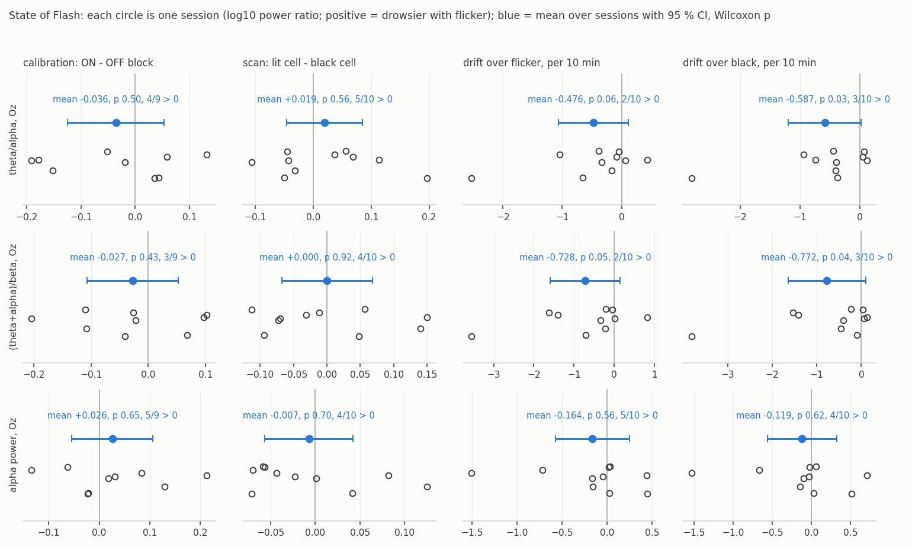
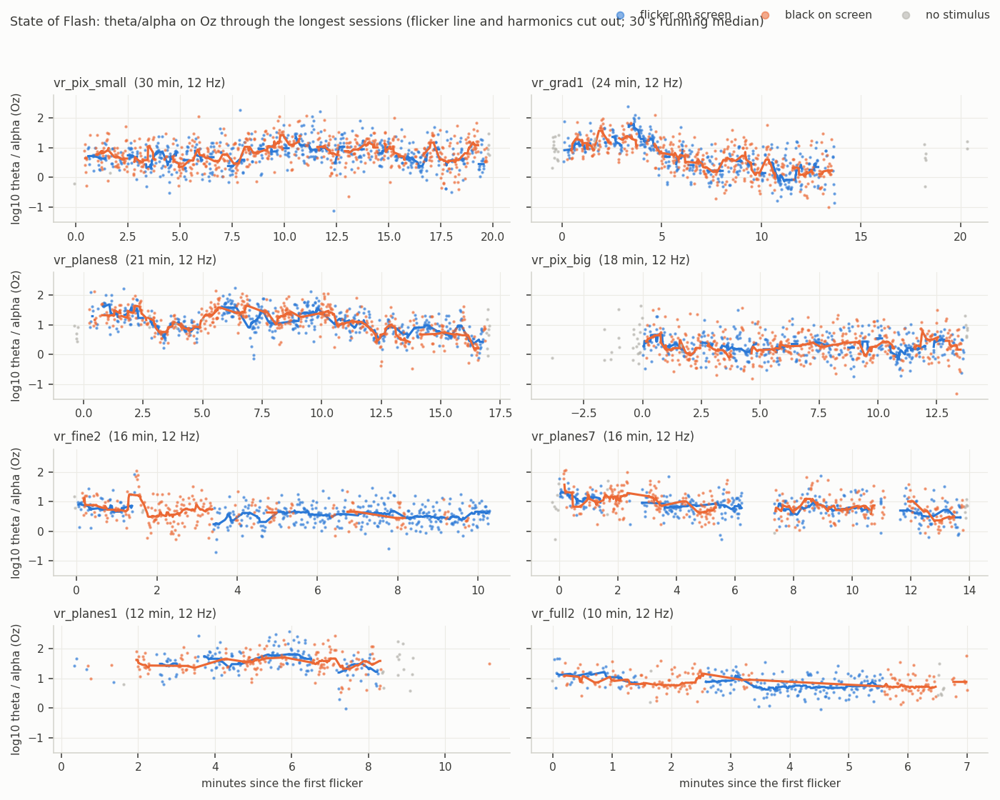

# State of Flash: does the flicker make you drowsy?

*Written 2026-10-07 from every session recorded so far. One subject, so every
pooled number below is over sessions of that one person, not over people.*

## The question

After the colour runs the subject reported that the flashing seemed to induce
drowsiness and help with sleep. Every recorded session is an unplanned
experiment on this: minutes of 12 Hz flicker interleaved, position by position
and block by block, with black. `analysis/state_of_flash.py` reads all of them
and asks the EEG three questions, with the flicker line, its harmonics and its
subharmonic cut out of every band first (a 12 Hz stimulus and its 6 Hz
subharmonic sit inside the alpha and theta bands, and would otherwise be read as
"drowsiness").

| question | how it is asked |
|---|---|
| **acute** | inside a session, is the EEG drowsier while a cell flickers than while a black cell is shown seconds before or after? Each flicker epoch is paired with the nearest black epoch within 45 s, so time on task is the same for both. Reported for the calibration blocks (ON and OFF strictly alternate, 8 s each) and for the scans (lit and black cells in serpentine order). |
| **drift** | does the marker climb with minutes of stimulation? Theil-Sen slope per session, over flicker epochs and over black epochs separately. If flicker itself were sedating, the slope over flicker would exceed the slope over black. |
| **net** | the minute before the first flicker against the minute after the last. (No session had a clean enough minute on both sides: the "before" minute is the headset going on.) |

Markers per 2 s epoch after a 1 to 40 Hz band-pass, on Oz (the aux electrode) and on the ears (TP9, TP10): log10 theta/alpha (4 to 7.5 Hz over 8 to 10.5 Hz), log10 (theta + alpha)/beta (beta 15 to 23 and 25 to 30 Hz), log10 alpha power. Eye closure as the share of time with Oz alpha above three times the eyes-open baseline for a second or more. Epochs over 150 uV on the channel group or more than 20 % blink are left out. Thirteen sessions have an Oz channel and a known flicker frequency; nine or ten contribute to each test.

## What the EEG says

**Acute: no.** With flicker on screen the EEG is not drowsier than with black on screen seconds away. On Oz, theta/alpha in the calibration blocks is -0.04 (95 % CI -0.12 to +0.05, p 0.50) and in the scans +0.02 (-0.05 to +0.09, p 0.56); (theta + alpha)/beta and alpha power are flat as well. The one effect that reaches p < 0.05 goes the other way: on the ears, theta/alpha is *lower* during the calibration ON blocks (-0.12, CI -0.24 to -0.01, p 0.049, 2 of 10 sessions positive). That is either the photic response spreading into the alpha band or a bright flashing field being mildly alerting; it is not a sign of drowsiness.

**Drift: present, but not from the flicker.** Oz theta/alpha falls through a session: -0.48 per 10 min over flicker epochs (p 0.06) and -0.59 over black epochs (p 0.027); (theta + alpha)/beta on Oz falls by -0.73 and -0.77 per 10 min (p 0.049 and 0.037). The slope is the same whether a cell is flashing or not, so it is time, not flicker. The ears show no such drift (-0.05 and -0.10 per 10 min, p 0.43 and 0.32), and a fall of half a log unit in ten minutes is far too large for a brain state; it has the signature of the wet Oz electrode settling after it is put on (less low-frequency noise, so less "theta"). The direction is also the opposite of drowsiness.

**Eye closure: no difference.** The share of time with closed-eye alpha on Oz is the same with flicker and with black (-0.03, p 0.08).

**Blinks: not measurable.** Under the headset the forehead electrodes AF7 and AF8 are essentially flat (99.9th percentile under 50 uV in the blink band, no blinks at any threshold inside sessions), so blink rate and slow eye movements, the best EEG-side markers of sleepiness, are not available from these recordings.

Numbers per session and pooled: `runs/state_of_flash/state_of_flash.json` (regenerated by the script; `runs/` is not in the repository).

## What this does and does not show

The recordings contain no EEG sign that the 12 Hz flicker makes the subject drowsier, acutely or over a session, on the markers the Muse can measure under the headset. They cannot refute the report either:

- There is no subjective rating (no sleepiness scale before and after), no reaction-time test, and no sleep measure after the session; the EEG markers here are proxies, and the frontal channels needed for the better ocular markers are dead under the headset.
- There is no control session of the same length without flicker. The audio-only session (`vr_music_cz1`) is the nearest thing and is too short on its own.
- Every session was at night, several of them around 2 am, when sleep pressure is high regardless of what is on the screen; what the subject felt afterwards may be the hour and twenty minutes of fixating a dot.
- Drowsiness after a session, rather than during it, is not something a within-session contrast can see.
- One subject.

## 2026-10-10: two colour runs in one evening, and the SSVEP as a fatigue meter

Two 8 by 4 colour-plane sessions on the Quest 3S, the first at 17:57
(`vr_planes9`, 21 min of stimulation) and the second at 19:50 (`vr_planes10`,
30 min). Three readings of the EEG, the blue plane (9 Hz) and the blue sweep
kept out of the spectral markers as tagged stages:

**The classic markers.** Theta/alpha on Oz did not climb in either run:
Theil-Sen drift over the flicker epochs -0.15 log10 per 10 min in the first
run, +0.01 in the second (dark epochs -0.04 in both). The acute contrast,
flicker against the nearest dark cell, was 0 in the first run and -0.1 in the
second (alpha a little higher under flicker, not theta). No sleep-onset
signature.

**No alpha rise on any electrode that held.** A first reading of the second
run showed the ear channels' alpha climbing threefold over the half hour.
That was the right ear electrode (TP10) coming loose at minute 11.2: 51 % of
its epochs over 150 uV in minutes 10-15, 23 uV RMS against 7 uV before, and
three times TP9 even in the epochs that pass the artifact gate. Per channel,
alpha on the dark cells drifted TP10 +0.28, TP9 -0.02, AF7 +0.05, AF8 +0.03,
Oz -0.03 log10 per 10 min. Alpha was flat everywhere else.

**The SSVEP itself faded, in two ways** (`analysis/flash_fatigue.py`,
`figures/state_of_flash_ssvep_fatigue.png`; `analysis/planes_passes.py`):

- The runs began in the same state: the colour calibrations matched (red
  +5.8, green +3.9, blue +5.0 against +5.0, +4.3, +5.5; white calibration Oz
  d' 4.4 against 5.6).
- Blue, scanned first at 9 Hz, read as dead in its second pass (minute 13-19;
  pass 1 alone 24 of 32, pass 2 alone 21, averaged 19). The loose ear
  electrode carries 0.15 of blue's weights and lifted the dark cells' score
  from 0.14 to 0.18; with the ear channels dropped the two passes together
  read 26 of 32. The response on Oz alone still fell from 0.34 to 0.19 between
  the passes, on a clean Oz contact: a real fading, cause open (adaptation,
  time on task).
- Red and green, scanned at minutes 20-30, read at half the first run's
  response (red 0.37 falling to 0.19 within its three minutes, against
  0.56-0.74 two hours earlier; green 0.16-0.23 against 0.33-0.39). The Oz
  contact's own noise rose from minute 20 (1-40 Hz RMS 10 to 80 uV, mains
  pick-up 20 to 50 uV), so for these two the electrode is the simpler
  explanation. Green still averaged to 31 of 32 over its two passes.

So the evening's drowsiness markers are null; what the evening did show is
in the next section, and for the camera the rule is in NEXT_SESSION.md: a
second run in the same evening is a different subject, and a pass is only
worth averaging in when the electrodes held through it.

## 2026-10-10, the subject's report: eyes irritated, a slight forehead ache, not drowsy

After the two runs the subject reported no drowsiness, irritated eyes and a
slight forehead ache. Four marker families were measured on the two runs and
on a reference day (`vr_planes8`, 2026-10-07, no report), and every finding
was then recomputed independently by two further analyses whose brief was
to refute it (19 of those checks completed): blinks and eye movements
(`analysis/flash_eog.py`), forehead muscle (`analysis/flash_frontalis.py`),
frontal theta and beta (`analysis/flash_frontal_theta.py`), and the things
that mimic them, contact, movement, stimulus leakage, jaw muscle, the pre-run
baseline (`analysis/flash_confounds.py`). Figures `figures/state_of_flash_eyes.png`,
`state_of_flash_forehead.png`, `state_of_flash_frontal_theta.png`,
`state_of_flash_confounds.png`; every number in
`docs/results/state_of_flash_2026-10-10/`.

**Eyes irritated: supported, between the runs.**

- A blink on a Muse under the headset is not a frontal event. Every channel
  is referenced to Fpz, so a blink appears as one identical negative pulse of
  about 60 uV on TP9, TP10 and the Oz cup, and only as a 3-16 uV gradient on
  AF7/AF8. The repo's 100 uV frontal blink detector therefore counts nothing
  (0.0-0.3 per minute); a far-channel detector, built independently by the
  measurer and by a refuter, agrees to the decimal.
- Blink rate on task: run 1 6-7 per minute, run 2 11-12, reference day 3-4.
  Run 2 ran at twice run 1 at matched minutes (+5 to +6 per minute, 19 of 21
  minutes, p < 0.001) from its first minutes (14 against 4.5 per minute in
  minutes 0-5), and the rate was flat within each run.
- While a 12 Hz cell flickered the subject nearly stopped blinking (2-4 per
  minute, against 30 per minute at the rest prompts) and let a burst go the
  moment the cell went dark (29-36 per minute in the first second). That
  suppress-then-release pattern is eyes held open on a bright target, which
  is how a cornea dries; it was present on the reference day at a lower level
  and strongest in run 2.
- No long or slow blinks at any point (0-1 % over 400 ms), amplitude and
  duration unchanged, bursts fell through run 2. Horizontal eye movements
  away from the cell rose fivefold through run 2 (low confidence; AF7-AF8 is
  a crude EOG).
- Reading: the eyes were already blinking twice as fast when run 2 began,
  after 21 minutes of flicker and the hour between. A doubled blink rate with
  an unchanged blink shape is what dry, irritated eyes look like in an EOG.
  One subject, a between-session difference, time of evening confounded.

**Forehead ache: not in the muscle and not in the EEG.**

- Forehead broadband power (frontalis EMG, 20-45 Hz, stimulus lines and
  mains cut) sat at 1.5-2.3 uV rms in all three sessions, 10-100x below a
  sustained contraction. Run 2, the run before the report, had the lowest
  level and a falling trend; the day-to-day level differences were electrode
  placement, stage composition and contact, not the forehead.
- One episode: the left forehead electrode's broadband power tripled for the
  last three minutes of run 1, a step at the green plane's onset, sustained,
  broadband, with no contact change by any proxy. Reproduced independently;
  one electrode, so muscle against a shifting pad is undecidable; nothing
  like it in run 2.
- Tonight only, the forehead carried 10-40 % more broadband power while a
  bright full-field block was lit than while it was black (both forehead
  electrodes, not the ears or Oz; absent on the reference day). In run 2 this
  is confined to the first 96 s of white calibration while the contact was
  still settling; in run 1 the 65-120 Hz band (+41 %) is the stronger piece.
  Its refuters did not finish, so it stands unverified; if real it is a
  periocular reaction (squinting) to the bright full-field flashes.
- Frontal theta did not rise with the flicker (-5 to -13 %), did not climb
  within either run, and was indistinguishable from the reference day;
  frontal beta fell through run 2. No mounting effort or tension. A headache
  has no EEG signature, and the forehead electrodes show nothing that would
  accompany one. The Quest's facial interface pressing on the forehead, which
  the EEG cannot see, is the likeliest cause.

**Not drowsy: supported.** No long blinks; no theta rise anywhere (Oz theta
-0.08 to -0.09 log10 per 10 min, frontal theta flat); frontal theta/alpha
fell 13-23 % while a cell flickered (alerting, identical on the reference
day); eye-closure share 4 % tonight against 11 % on the reference day.

**Confounds measured, all verified.** Mains pick-up fell 3-4x on every
channel in run 2 (the environment or the reference path, not forehead
contact); whole-head movement on task is rare (1 event in run 1, 0 in run 2);
no 12 Hz or 9 Hz line reaches the forehead (upper limit 0.37 uV against
4-5 uV on Oz), so frontal contrasts are not photic driving; no eyes-open
pre-run baseline exists in any session (the three minutes before the first
flicker are headset handling); the 1-4 Hz frontal lit/dark gap is the
blink-rate difference, not cortex; the ear EMG level is contact, not jaw.
The sweep and the off-frequency blue plane were mislabelled in this script
(lit sweep blocks counted as dark, black blue cells as tagged); fixed, and
no acute contrast changed.

| marker | run 1 (17:57) | run 2 (19:50) | reference day | reads as |
|---|---|---|---|---|
| blink rate on task, per min | 6.8 | 12.1 | 4.1 | eyes irritated by run 2 |
| blinks while a 12 Hz cell flickers / after it goes dark | 2-5 / 29 | 4-10 / 36 | 2 / 8 | eyes held open, released on black |
| blinks over 400 ms | 1 % | 0 % | 0 % | not drowsy |
| forehead 20-45 Hz, uV rms | 2.3 | 1.7 | 2.1 | no frontalis tension |
| left forehead, last 3 min of run 1 | x2.7 | x0.3 | x0.4 | one episode, undecidable |
| frontal theta drift, log10 per 10 min | -0.10 | +0.01 | -0.19 | no effort build-up |
| Oz theta drift, log10 per 10 min | -0.09 | -0.08 | -0.43 | not drowsy |
| alpha drift on the dark cells (TP9 / Oz / TP10) | -0.06 / -0.02 / 0.00 | -0.02 / -0.03 / +0.28 | | TP10 loose from minute 11 of run 2 |

## What is known about flicker near the alpha rhythm

Flicker at 10 Hz is the classic probe of the alpha rhythm. Stimulating from 1
to 100 Hz, Herrmann's group found the EEG resonating most at 10, 20, 40 and
80 Hz, the 10 Hz resonance being tied to the mechanism of spontaneous alpha
([Frontiers in Human Neuroscience, 2016](https://www.frontiersin.org/journals/human-neuroscience/articles/10.3389/fnhum.2016.00413/pdf)),
and driving is strongest when the flicker sits close to a person's own alpha
frequency. What happens *after* the flicker is the part that matters for a
sleep claim: in 30 healthy volunteers, 10 Hz photic stimulation was followed by
a *decrease* of alpha power in about 70 % of them, modulated by how far the
flicker sat from each person's alpha frequency
([Uniform decrease of alpha global field power induced by intermittent photic stimulation](https://publikationen.ub.uni-frankfurt.de/opus4/frontdoor/index/index/year/2010/docId/20015)).
A drop in alpha after stimulation is not the signature of sleep onset (that is
alpha giving way to theta with slow eye movements), so the published
after-effect of alpha-band flicker does not by itself predict drowsiness; the
relaxation and sleep claims for audio-visual "entrainment" devices rest on much
weaker evidence. Two cautions follow for any flicker-for-sleep use: flicker
between about 3 and 30 Hz is the range that provokes photosensitive seizures in
susceptible people, and 12 Hz full-field flicker in a headset is exactly that
stimulus; and the alpha-suppression after-effect depends on the individual's
alpha frequency, so a sleep protocol would have to be tuned per person.

## A State of Flash study that could answer it

The stimulus page already does everything needed; what is missing is the design and two questions to the subject.

1. **Blocks, counterbalanced, same luminance.** Five minutes each of: full-field 12 Hz flicker (the calibration ON stimulus), static grey at the flicker's mean luminance, and black with the fixation dot. Order rotated across sessions; at least three sessions per order; daytime as well as night.
2. **A sleepiness rating before and after every block** (the Karolinska Sleepiness Scale, 1 to 9, asked on the page and answered with the controller) and **a two-minute reaction-time test** after each block (the page shows a dot at random intervals, the subject pulls the trigger; median reaction time and lapses over 500 ms are the standard objective sleepiness measure).
3. **The same EEG markers**, plus heart rate variability if the Muse's optical sensor is streamed, and the Oz electrode given five minutes to settle before the first block so the drift seen here is out of the way.
4. **A fourth, optional block** at a lower frequency (8 or 10 Hz, inside the subject's alpha band) and one at 40 Hz, since the claim in the entrainment literature is frequency-specific and the 12 Hz used for the pictures was chosen for the SSVEP, not for sleep.
5. **More than one person.** The effect, if there is one, is a claim about people, not about this subject's electrode.

Three sessions of that design take under an hour each and would turn "it seems to make me sleepy" into a number with an interval around it.
